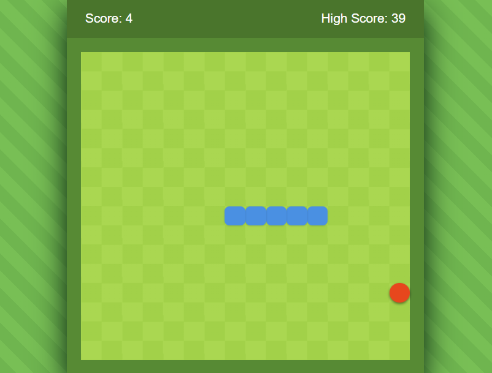

# 🐍 Snake Game

Un juego clásico de la serpiente desarrollado con **HTML, CSS y JavaScript** como proyecto de práctica para la materia de Programación II.

---

## 📷 Vista previa

---

## 🎮 Características

- Movimiento mediante las flechas del teclado.
- Generación aleatoria de comida.
- La comida nunca aparece sobre la serpiente.
- Sistema de puntaje.
- Guardado del puntaje máximo mediante LocalStorage.
- Pantalla personalizada de Game Over.
- Sonidos al comer, perder y reiniciar la partida.
- Diseño responsive.

---

## 🛠 Tecnologías utilizadas

- HTML5
- CSS3
- JavaScript (ES6)

---

## 📚 Conceptos aplicados

- Manipulación del DOM.
- Eventos de teclado.
- CSS Grid.
- LocalStorage.
- Temporizadores (`setInterval`).
- Arreglos y lógica de colisiones.
- Generación aleatoria.
- Reproducción de audio mediante JavaScript.

---

## 🎵 Recursos utilizados

Los efectos de sonido fueron obtenidos de **Pixabay**, bajo su licencia de contenido.

https://pixabay.com/sound-effects/

---

## 👨‍💻 Autor

Ariel

Proyecto realizado con fines educativos.
